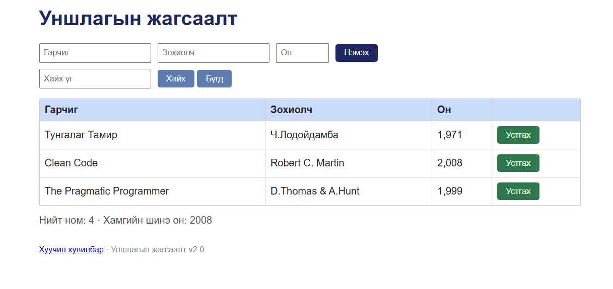

# BUG-01: Нийт номын тоолуур бодит тооноос нэгээр их харагдана

Орчин: Уншлагын жагсаалт v2.0; Microsoft Edge 155.0.4283.45 (64-bit), Windows; сервер Ubuntu/WSL2, Node.js v22.22.1; 2026-10-15.

Урьдчилсан нөхцөл: Ажиллаж байгаа серверийг Ctrl+C-ээр зогсоож, node app.js командаар шинээр асаасан. Анхны 3 номтой төлөв.

## Дахин гаргах алхам
1. Урьдчилсан нөхцөлийн дагуу аппыг шинээр асаана.
2. http://localhost:3000 хаягийг нээж, шаардлагатай бол refresh хийнэ.
3. Хайлт хийхгүйгээр хүснэгтийн номын мөрүүдийг тоолно.
4. Доорх «Нийт ном» тоолууртай харьцуулна.

Хүлээгдэж байсан: Спецификациар тоолуур хүснэгтийн номын тоотой тэнцүү; анхны төлөвт 3 байна.

Бодит үр дүн: Хүснэгтэд 3 ном байгаа боловч «Нийт ном: 4» гэж харагдана.

Ноцтой байдал: Minor — хэрэглэгчид номын тооны буруу мэдээлэл өгнө, үндсэн үйлдлийг хаахгүй.

Олдсон аялал: Supermodel (GUI).

## Нотолгоо

