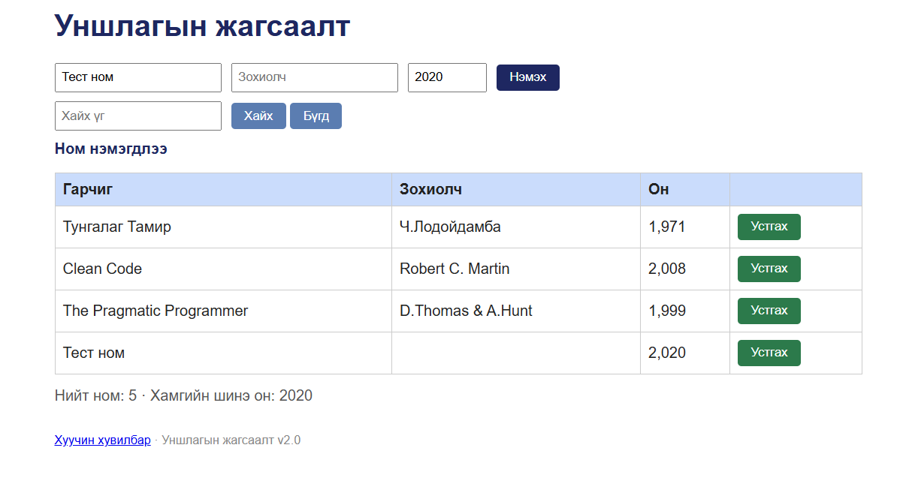
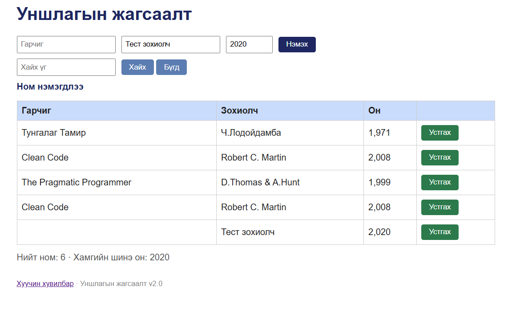
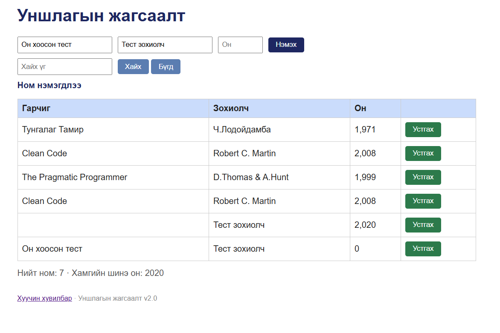

# BUG-05: Заавал бөглөх талбар хоосон байхад ном нэмэгдэнэ

Орчин: Уншлагын жагсаалт v2.0; Microsoft Edge 155.0.4283.45 (64-bit), Windows; сервер Ubuntu/WSL2, Node.js v22.22.1; 2026-10-15.

Урьдчилсан нөхцөл: Серверийг Ctrl+C-ээр зогсоож, node app.js командаар шинээр асаасан. Браузерт http://localhost:3000 хаягийг refresh хийсэн. Анхны 3 номтой төлөв.

## Дахин гаргах алхам
1. Аппыг урьдчилсан нөхцөлийн дагуу шинээр асаана.
2. Гарчигт «Тест ном» оруулна.
3. Зохиолчийг хоосон үлдээнэ.
4. Онд 2020 оруулна.
5. «Нэмэx» товч дарна.

Хүлээгдэж байсан: Гарчиг, Зохиолч, Он бүгд заавал бөглөгдөх ёстой. Ном нэмэгдэхгүй, ойлгомжтой алдааны мессеж гарна.

Бодит үр дүн: Зохиолч хоосон мөр нэмэгдэж, «Ном нэмэгдлээ» мессеж гарна.

## Нэмэлт тохиолдлууд
Тохиолдол бүрийг шалгахдаа аппыг шинээр асаана:
- Гарчиг хоосон, Зохиолч: Тест зохиолч, Он: 2020 — хоосон гарчигтай ном нэмэгдэнэ.
- Гарчиг: Он хоосон тест, Зохиолч: Тест зохиолч, Он хоосон — ном нэмэгдэж, он 0 болно.

Нэмэлт зургууд нь анхны session-ий хуримтлагдсан өгөгдөлтэй үеийнх; үндсэн алхмын зураг нь bug-05.png.

Ноцтой байдал: Major — шаардлагатай мэдээлэлгүй ном хадгалагдаж, өгөгдлийн бүрэн бүтэн байдал алдагдана.

Олдсон арга: Charter-ийн хоосон оролтын шалгалт.

## Нотолгоо

