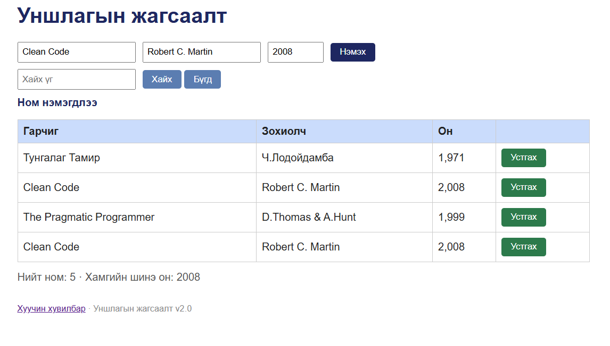

# BUG-06: Ижил гарчиг, зохиолчтой ном давхар нэмэгдэнэ

Орчин: Уншлагын жагсаалт v2.0; Microsoft Edge 155.0.4283.45 (64-bit), Windows; сервер Ubuntu/WSL2, Node.js v22.22.1; 2026-10-15.

Урьдчилсан нөхцөл: Серверийг Ctrl+C-ээр зогсоож, node app.js командаар шинээр асаасан. Браузерт http://localhost:3000 хаягийг refresh хийсэн. Анхны 3 номтой төлөв.

## Дахин гаргах алхам
1. Аппыг урьдчилсан нөхцөлийн дагуу шинээр асаана.
2. Гарчигт Clean Code оруулна.
3. Зохиолчид Robert C. Martin оруулна.
4. Онд 2008 оруулна.
5. «Нэмэx» товч дарна.

Хүлээгдэж байсан: Ижил гарчиг, зохиолчтой ном давхар нэмэгдэхгүй. Clean Code нэг мөр хэвээр байна.

Бодит үр дүн: «Ном нэмэгдлээ» мессеж гарч, Clean Code хоёр мөр болно. Хүснэгтэд нийт 4 ном байна.

Ноцтой байдал: Major — давхардсан өгөгдөл үүсэж, жагсаалтын үнэн зөв байдал алдагдана.

Олдсон арга: Charter-ийн давхардсан оролтын шалгалт.

## Нотолгоо

