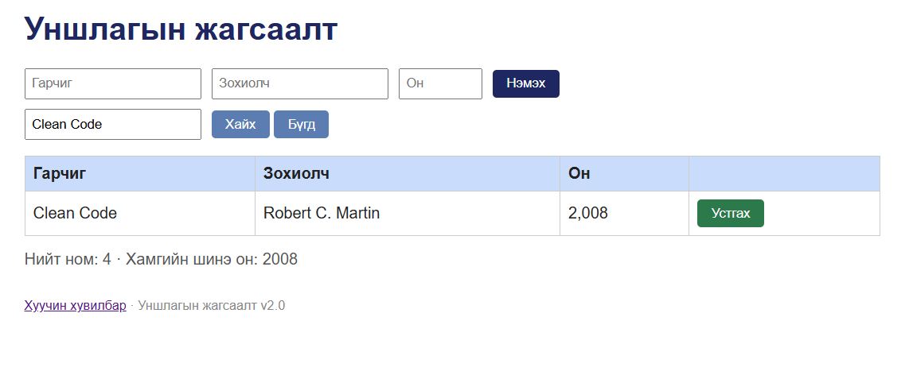
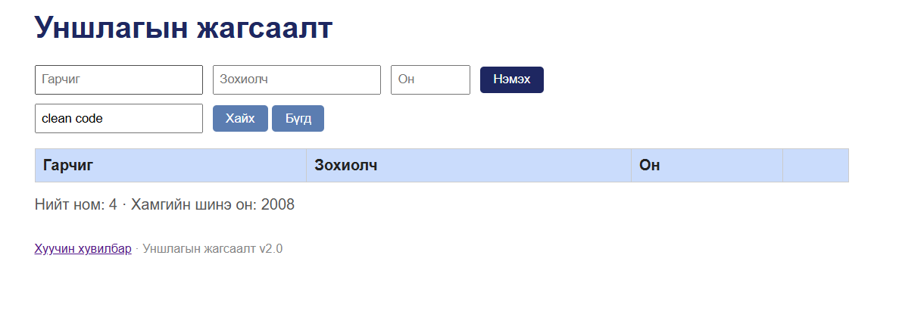

# BUG-07: Хайлт том болон жижиг үсэг ялгана

Орчин: Уншлагын жагсаалт v2.0; Microsoft Edge 155.0.4283.45 (64-bit), Windows; сервер Ubuntu/WSL2, Node.js v22.22.1; 2026-10-15.

Урьдчилсан нөхцөл: Серверийг Ctrl+C-ээр зогсоож, node app.js командаар шинээр асаасан. Браузерт http://localhost:3000 хаягийг refresh хийсэн. Анхны 3 номтой төлөв.

## Дахин гаргах алхам
1. Аппыг урьдчилсан нөхцөлийн дагуу шинээр асаана.
2. Хайлтад Clean Code оруулж «Хайх» дарна.
3. Нэг мөр олдсоныг ажиглана.
4. Хайлтын утгыг clean code болгон сольж «Хайх» дарна.

Хүлээгдэж байсан: Хайлт том/жижиг үсэг ялгахгүй тул хоёр хайлтад ижил нэг ном олдоно.

Бодит үр дүн: Clean Code хайхад 1 мөр, clean code хайхад 0 мөр гарна.

Ноцтой байдал: Major — байгаа номыг зөвхөн үсгийн хэмжээнээс шалтгаалан олохгүй байна.

Олдсон арга: Charter-ийн том/жижиг үсэгтэй хайлтын шалгалт.

## Нотолгоо

