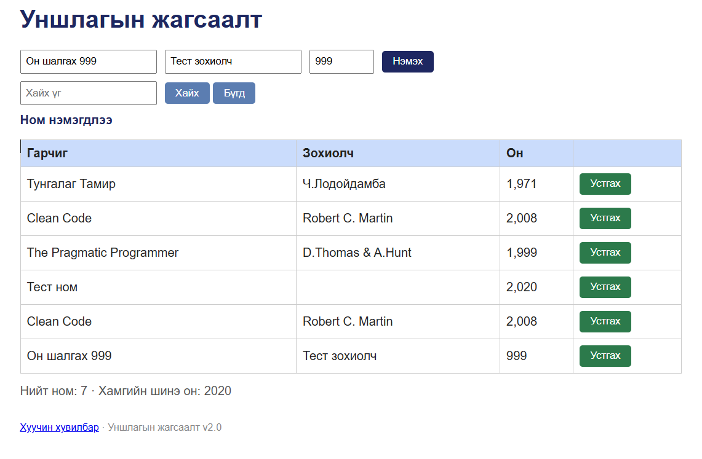
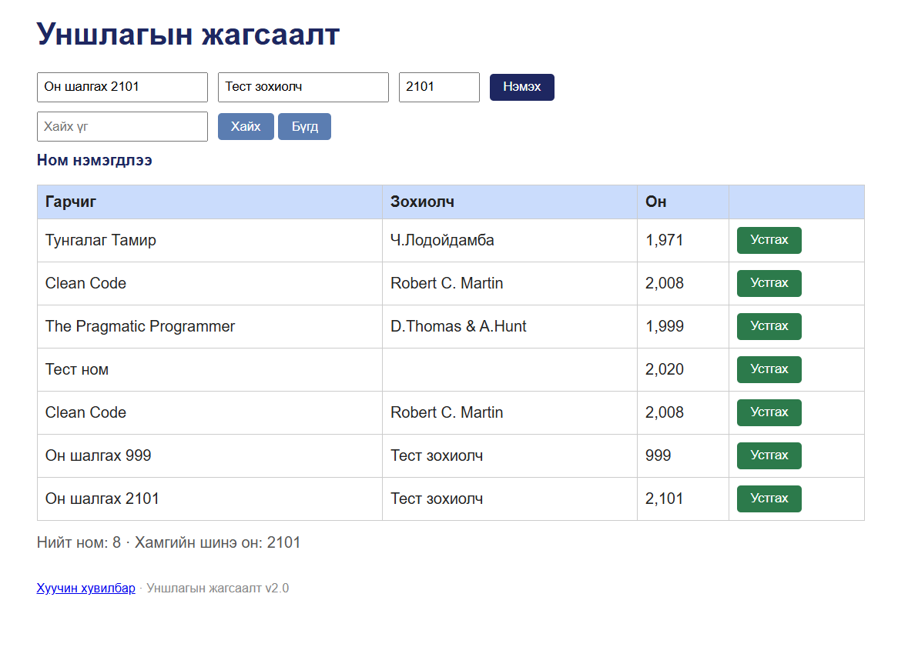
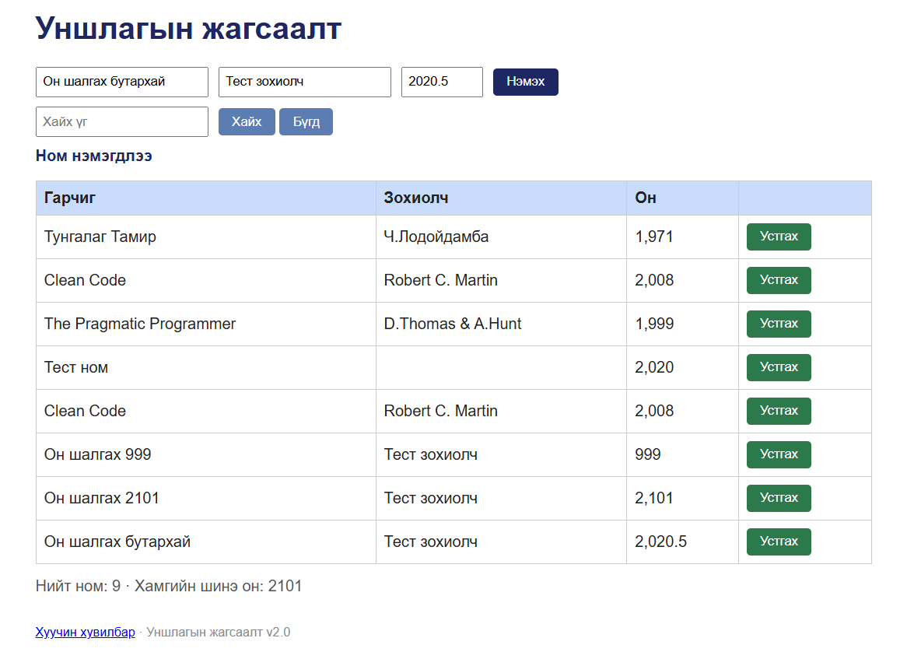

# BUG-08: Оны хязгаараас гадуурх болон бутархай утгыг зөвшөөрнө

Орчин: Уншлагын жагсаалт v2.0; Microsoft Edge 155.0.4283.45 (64-bit), Windows; сервер Ubuntu/WSL2, Node.js v22.22.1; 2026-10-15.

Урьдчилсан нөхцөл: Серверийг Ctrl+C-ээр зогсоож, node app.js командаар шинээр асаасан. Браузерт http://localhost:3000 хаягийг refresh хийсэн. Анхны 3 номтой төлөв.

## Дахин гаргах алхам
1. Аппыг урьдчилсан нөхцөлийн дагуу шинээр асаана.
2. Дараах номуудыг хүснэгтийн дарааллаар нэг нэгээр нь оруулж, тус бүрд «Нэмэx» дарна.

| Гарчиг | Зохиолч | Он |
|---|---|---|
| Он шалгах 999 | Тест зохиолч | 999 |
| Он шалгах 2101 | Тест зохиолч | 2101 |
| Он шалгах бутархай | Тест зохиолч | 2020.5 |

Хүлээгдэж байсан: Он 1000–2100 хоорондох бүхэл тоо байх ёстой. Гурван оролт бүгд татгалзагдаж, ном нэмэгдэхгүй.

Бодит үр дүн: Гурван ном бүгд нэмэгдэнэ. Он 999, 2,101, 2,020.5 гэж харагдана.

Нотолгооны зургууд нь анхны session-ий бусад тестийн номтой үеийнх тул нийт мөрийн тоо дээрх тусгаарласан алхмынхаас ялгаатай.

Ноцтой байдал: Major — хүчингүй онтой өгөгдөл хадгалах боломжтой.

Олдсон арга: Charter-ийн оны хязгаар болон бүхэл тооны шалгалт.

## Нотолгоо

