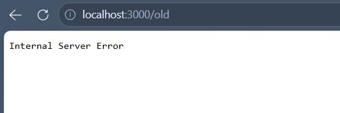

# BUG-09: Хуучин хувилбар линк HTTP 500 алдаа буцаана

Орчин: Уншлагын жагсаалт v2.0; Microsoft Edge 155.0.4283.45 (64-bit), Windows; сервер Ubuntu/WSL2, Node.js v22.22.1; 2026-10-15.

Урьдчилсан нөхцөл: Серверийг Ctrl+C-ээр зогсоож, node app.js командаар шинээр асаасан. Браузерт http://localhost:3000 хаягийг refresh хийсэн. Анхны 3 номтой төлөв.

## Дахин гаргах алхам
1. Аппыг урьдчилсан нөхцөлийн дагуу шинээр асаана.
2. Үндсэн хуудасны доод талын «Хуучин хувилбар» линк дарна.
3. /old хуудасны хариуг ажиглана.
4. Өөр Ubuntu терминалд дараах командыг ажиллуулна:

    curl -i http://localhost:3000/old

Хүлээгдэж байсан: Спецификациар бүх хуудас, линк ажиллана. Холбогдсон хуудас серверийн алдаагүй нээгдэнэ.

Бодит үр дүн: HTTP/1.1 500 Internal Server Error буцааж, браузерт Internal Server Error харагдана.

Ноцтой байдал: Major — линкээр очих хуудас ашиглах боломжгүй.

Олдсон арга: Линк дагах шалгалт; curl-ээр HTTP түвшинд баталгаажуулсан.

## Нотолгоо

[Бүтэн HTTP хариу](../evidence/bug-09-curl.txt)
