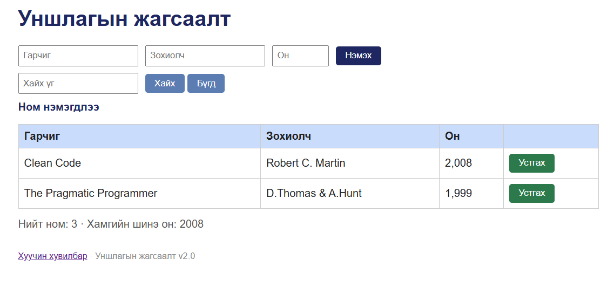

# BUG-10: Ном устгасны дараа Ном нэмэгдлээ мессеж гарна

Орчин: Уншлагын жагсаалт v2.0; Microsoft Edge 155.0.4283.45 (64-bit), Windows; сервер Ubuntu/WSL2, Node.js v22.22.1; 2026-10-15.

Урьдчилсан нөхцөл: Серверийг Ctrl+C-ээр зогсоож, node app.js командаар шинээр асаасан. Браузерт http://localhost:3000 хаягийг refresh хийсэн. Анхны 3 номтой төлөв.

## Дахин гаргах алхам
1. Аппыг урьдчилсан нөхцөлийн дагуу шинээр асаана.
2. Ном нэмэх үйлдэл хийхгүй.
3. Тунгалаг Тамир номын мөрийн «Устгах» товч дарна.
4. Үлдсэн мөрүүд болон үйлдлийн мессежийг ажиглана.

Хүлээгдэж байсан: Тунгалаг Тамир устаж, устгах үйлдэлд тохирсон мессеж гарна.

Бодит үр дүн: Сонгосон ном устаж, 2 мөр үлдсэн боловч «Ном нэмэгдлээ» мессеж гарна.

Ноцтой байдал: Minor — устгах үйлдэл хийгдсэн ч хэрэглэгчид эсрэг утгатай мэдээлэл өгнө.

Олдсон арга: Charter-ийн устгах үйлдэл, мессежийн шалгалт.

## Нотолгоо

