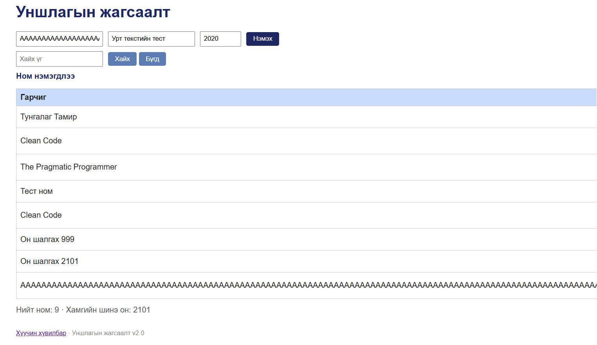

# BUG-11: Урт гарчиг хүснэгтийг дэлгэцээс хэтрүүлж Устгах товчийг харагдахгүй болгоно

Орчин: Уншлагын жагсаалт v2.0; Microsoft Edge 155.0.4283.45 (64-bit), Windows; сервер Ubuntu/WSL2, Node.js v22.22.1; 2026-10-15.

Урьдчилсан нөхцөл: Серверийг Ctrl+C-ээр зогсоож, node app.js командаар шинээр асаасан. Браузерт http://localhost:3000 хаягийг refresh хийсэн. Анхны 3 номтой төлөв.

## Дахин гаргах алхам
1. Аппыг урьдчилсан нөхцөлийн дагуу шинээр асаана.
2. Браузерыг нотолгооны зурагтай ижил цонхны хэмжээнд байлгана.
3. Ubuntu терминалд python3 -c "print('A' * 300)" ажиллуулна.
4. Гарсан залгаа 300 ширхэг A үсгийг Гарчиг талбарт хуулна.
5. Зохиолчид «Урт текстийн тест», онд 2020 оруулна.
6. «Нэмэx» дарж, хүснэгтийн өргөн болон баруун талын товчийг ажиглана.

Хүлээгдэж байсан: Спецификациар хүснэгт ямар ч урттай оролтод эвдрэхгүй. Урт гарчгийг зохицуулж, үйлдлийн товчийг ашиглах боломжтой байлгана.

Бодит үр дүн: Хүснэгт дэлгэцийн өргөнөөс хэтэрч, «Устгах» товч харагдахгүй болно.

Нотолгоо нь анхны session-ий бусад тестийн номтой үеийнх. Нийт мөрийн тоо нь согогийн шалгуур биш.

Ноцтой байдал: Minor — урт гарчигтай үед байрлал алдагдаж, устгах товчид хүрэхэд хүндрэлтэй болно.

Олдсон аялал: Supermodel (GUI).

## Нотолгоо

